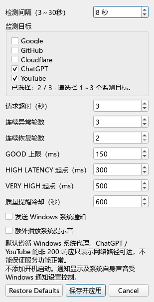
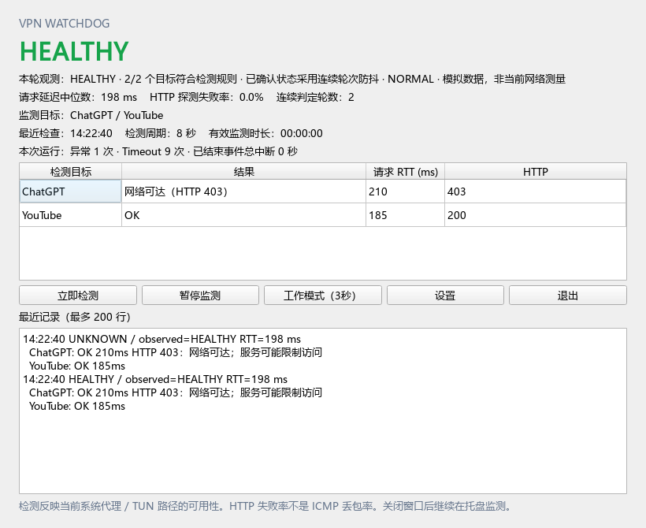

# VPN Watchdog 中文使用说明

VPN Watchdog / Network Guardian 是 Windows 后台网络监测工具。它定期访问你选择的国际服务，在连续多轮连接异常或恢复时提醒你。

它不会连接 VPN、切换节点或提高网速。请先使用自己的 VPN 客户端连接网络；程序通过当前 Windows 系统代理或 TUN 路由检测访问情况。

## 1. 下载与启动

1. 打开项目 GitHub 首页，点击右侧 **Releases**。
2. 在发布版本的 **Assets** 中下载 `VPNWatchdog.exe` 或 Windows 压缩包。不要把 GitHub 自动生成的 Source code 当成安装包。
3. 如果下载压缩包，先解压到一个普通文件夹。
4. 双击 `VPNWatchdog.exe`。无需安装 Python，通常不需要管理员权限。
5. 程序默认进入右下角系统托盘；若未看到图标，展开 Windows 隐藏图标区域。
6. 双击托盘图标打开主界面。

面向 Windows 10/11 x64，已在 Windows 11 x64 测试；Windows 10、干净机器与长期运行仍需进一步验收。EXE 尚未签名，Windows 的提示取决于本机策略；请核对发布来源和提供的 SHA-256。

也可在 EXE 所在目录打开 PowerShell，直接显示主界面：

```powershell
.\VPNWatchdog.exe --dashboard
```

## 2. 第一次使用

1. 在 VPN 客户端开启系统代理或 TUN，并确认已连接。
2. 启动本程序，等待几轮检测。默认每 5 秒检查 Google、GitHub、Cloudflare。
3. 主界面会显示目标的 HTTP 响应、请求 RTT、整体状态和最近记录。
4. 程序采用连续轮次确认，因此启动时显示 UNKNOWN 是正常现象。
5. 在托盘菜单选择 **Test Notification**，确认 Windows 能正常显示通知。

如果浏览器使用单独的代理插件，而 Windows 没有配置系统代理或 TUN，浏览器能访问某个网站不代表本程序也能访问。

## 3. 设置检测频率与网站

点击主界面 **设置**：

- **检测间隔**：输入 3～30 的整数秒，例如 8 或 12。点击“保存并应用”后生效，无需重启。
- **监测目标**：从 Google、GitHub、Cloudflare、ChatGPT、YouTube 中选择 1～3 个。程序阻止取消最后一项和选择第 4 项。
- **恢复默认**：恢复 5 秒周期、Google/GitHub/Cloudflare 及其他默认参数。
- **通知与声音**：控制异常/恢复系统通知和额外提示音；Windows 自身的通知声音仍由系统控制。

改变目标集合会清除当前状态证据、RTT 和界面近期记录，等待新组合的结果；磁盘日志保留。仅改变检测周期不会清空状态。



## 4. 工作模式是什么意思

工作模式是临时提高检测频率：开启后每 **3 秒**检查一次，关闭后恢复你保存的普通周期。

例如普通周期为 15 秒：开启工作模式变成 3 秒，关闭后恢复 15 秒。工作模式期间把普通周期保存为 12 秒，实际仍为 3 秒，关闭后变成 12 秒。

工作模式不会修改 VPN 或网络设置，只会增加检测请求次数。关闭程序后重新启动，按普通模式运行。

## 5. 状态与统计含义

| 状态 | 含义 |
|---|---|
| UNKNOWN | 正在等待足够证据，或监测器暂时不可用 |
| HEALTHY | 当前目标达到成功门槛，成功请求的延迟低于阈值 |
| HIGH_LATENCY | 达到成功门槛，但成功请求的延迟中位数较高 |
| UNSTABLE | 有目标可达，但成功数不足门槛 |
| VPN_DOWN | 所有启用目标真正无法连接，并连续达到异常轮数 |
| NO_INTERNET | Windows 无已连接的非 loopback 网卡，并连续达到异常轮数 |
| RECOVERED | 已确认异常后，连续达到恢复门槛 |
| PAUSED | 用户已暂停自动监测 |

成功门槛：选 1 个需 1/1，选 2 个需 2/2，选 3 个需 2/3 或 3/3。三个目标中一个失败不会直接判掉线，界面会注明异常目标。

默认连续 3 轮异常才确认 Down，连续 2 轮达到成功门槛才确认恢复。界面的“本轮观测”是当前一轮结果，“已确认状态”可能仍在等待连续证据。

- **请求 RTT**：包括 DNS、代理、TCP、TLS 和响应耗时，不是 ping 延迟。
- **延迟中位数**：只用成功目标的 RTT；超时不作为 0 ms。
- **HTTP 探测失败率**：失败目标数除以本轮目标数，不是 ICMP 丢包率。
- **连续判定轮数**：连续检测证据轮数，不是成功网站数量。

ChatGPT/YouTube 使用轻量 HEAD 探测。403、重定向或其他有效 HTTP 响应会标为网络可达并注明服务情况；这不能保证账号登录、模型使用或视频播放正常。DNS、代理、连接、请求超时及 TLS 错误仍算连接失败。



## 6. 立即检测、暂停与退出

- **立即检测**：空闲时马上检查；检测中显示忙状态，不叠加请求。暂停时点击会恢复监测。
- **暂停监测**：停止自动探测；再点击恢复。
- **关闭主窗口**：继续在系统托盘后台监测。
- **真正退出**：点击主界面“退出”或托盘菜单 **Exit**。

同一个数据目录只能运行一个主程序实例。本程序没有自动添加开机启动。

## 7. 配置与日志在哪里

默认保存于：

```text
%LOCALAPPDATA%\VPNWatchdog\config\settings.json
%LOCALAPPDATA%\VPNWatchdog\logs\network.log
```

将路径粘贴到文件资源管理器地址栏即可打开。设置窗口保存后，普通周期和目标组合在退出重启后恢复。工作模式是临时开关，不覆盖普通周期。

旧配置会自动迁移；无效周期、目标或 JSON 会修复，修复前原文件保留为 `settings.json.bak`，日志记录 CONFIG_REPAIRED。日志按大小轮转。

需要独立数据目录时：

```powershell
.\VPNWatchdog.exe --dashboard --data-dir "D:\VPNWatchdogData"
```

## 8. 常见问题

**浏览器正常，但这里失败？** 检查浏览器是否使用单独插件，以及 VPN 是否开启 Windows 系统代理或 TUN；查看每个目标的错误类型。

**正常网络也显示高延迟？** HTTPS 请求包含连接和代理耗时，比 ping 高；观察正常网络基线后，在设置中调整延迟阈值。

**关闭 VPN 仍显示健康？** 当前网络可能可以直连目标，也可能系统代理/TUN 仍在处理流量。本程序检测访问路径，不检查 VPN 进程。

**没有收到通知？** 先运行 Test Notification，再检查本程序通知开关、Windows 通知设置与勿扰模式。

**出现 MONITOR_TIMEOUT？** 表示探测进程或系统代理/PAC 查询未响应，程序会尝试恢复；这不能直接证明 VPN 掉线。

**找不到托盘图标？** 展开隐藏图标，或用 `--dashboard` 启动。

**如何卸载？** 通过 Exit 退出后删除 EXE 所在文件夹。需要清除设置和日志时，再手动删除 `%LOCALAPPDATA%\VPNWatchdog`。

## 9. 从源码运行

如果尚未发布 EXE，或需要自己修改代码，安装 Python 3.11+ 后，在项目根目录执行：

```powershell
python -m venv .venv
.\.venv\Scripts\python.exe -m pip install -r requirements.txt
.\.venv\Scripts\python.exe main.py --dashboard
```

开发、测试和打包说明见仓库 README；本轮测试证据见 `docs/ROUND2.md`。
